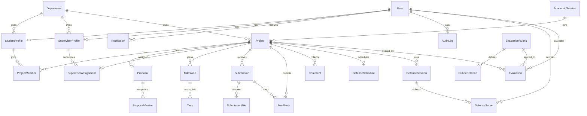

# FYP Manager - Smart Final Year Project Management System

A comprehensive, real-time enabled Final Year Project Management System designed for universities to streamline the entire FYP lifecycle - from proposal submission to defense evaluation. Built with modern technologies and intelligent features to make project management more efficient and unique.

## Live Deployment

| Service | URL |
|---------|-----|
| **Web App (Frontend)** | https://fypmanager.vercel.app |
| **REST API (Backend)** | https://fyp-manager-api.vercel.app/api/v1 |
| **API Health Check** | https://fyp-manager-api.vercel.app/health |
| **Source Code** | https://github.com/Sharjeel9811/fyp-Manager |

**Demo accounts** (password `password123` for all): `student@fypmanager.com`, `supervisor@fypmanager.com`, `admin@fypmanager.com`

> **Why the backend has two targets:** Vercel serverless functions are request-scoped, so they can serve the REST API but cannot hold a Socket.IO connection open and cannot share in-memory presence between instances. The frontend therefore lives on Vercel, while the same Express app is also deployed as a long-running Node service (see [Real-Time Deployment](#real-time-deployment-render)). Until that service is created, every dashboard keeps polling its REST data (15s interval + refetch on tab focus) and the Live Activity panel shows the real connection state instead of pretending to be live.

## Table of Contents
- [Overview](#overview)
- [Key Features](#key-features)
- [Real-Time Features](#real-time-features)
- [Live Defense Mode](#live-defense-mode)
- [Similarity Check, GitHub Feed & Mock Defense](#similarity-check-github-feed--mock-defense)
- [Kanban Board, Theme Switcher & Profile Pictures](#kanban-board-theme-switcher--profile-pictures)
- [Tech Stack](#tech-stack)
- [Architecture](#architecture)
- [Authentication & Security](#authentication--security)
- [Database Models](#database-models)
- [API Endpoints](#api-endpoints)
- [Frontend Structure](#frontend-structure)
- [Setup Instructions](#setup-instructions)
- [Real-Time Deployment (Render)](#real-time-deployment-render)
- [Testing](#testing)
- [File Storage](#file-storage)
- [Default Credentials](#default-credentials)
- [Project Health Monitor Logic](#project-health-monitor-logic)
- [Smart Features Logic](#smart-features-logic)
- [Contributing](#contributing)
- [License](#license)

## Overview

FYP Manager is a full-stack web application that digitizes and automates the Final Year Project management process. It provides role-based dashboards for Students, Supervisors, and Administrators with intelligent features like rule-based supervisor matching, explainable readiness scoring, real-time collaboration, and live activity tracking.

## Key Features

### For Students
- **Dashboard Overview** - Real-time project status, milestones, feedback, and defense readiness score
- **Project Proposal Management** - Draft, edit, and submit proposals with version control
- **Team Formation** - Create teams and invite members (max 4 members)
- **Milestone Tracking** - View assigned milestones with progress tracking
- **Document Submission** - Upload deliverables with submission history
- **Feedback & Comments** - Receive and respond to supervisor feedback
- **Defense & Evaluation** - View defense schedule and released evaluations
- **Live Defense Room** - Follow the panel's shared countdown, see which rubric criterion is being discussed, watch evaluators submit in real time, and receive your released scores in the same page
- **Mock Defense Practice** - Answer five panel-style questions about your proposal and get instant per-answer scoring, strengths, and improvement hints (LLM examiner when a key is configured, deterministic otherwise); results never touch official evaluations
- **GitHub Contribution Feed** - Link the team's public repository and the project page shows live commits, contributors, and repository pulse
- **Kanban Task Board** - Drag-and-drop board (`To do / In progress / In review / Done`) with priorities, assignees, and due dates; moves broadcast to the whole team over sockets
- **Profile Picture** - Upload a photo from the profile page; it is resized in the browser and shows up in the sidebar, header, and dropdown instantly
- **Defense Readiness Score** - Explainable, rule-based score (proposal, progress, submissions, health) with actionable recommendations
- **Profile Management** - Update profile and change password with real-time token rotation

### For Supervisors
- **Supervision Dashboard** - Overview of all assigned projects with health metrics
- **Proposal Reviews** - Review and approve/reject/revise student proposals
- **Submission Reviews** - Evaluate deliverables with structured feedback
- **Milestone Management** - Track milestone progress across projects
- **Project Health Monitor** - Rule-based risk assessment with explanations
- **Evaluation Schedule** - View upcoming defense schedules
- **Live Defense Scoring** - Score the current rubric criterion during the defense; scores lock on submit and the panel aggregate updates instantly
- **Supervision Reports** - Analytics and CSV exports
- **Real-time Notifications** - Instant alerts for new submissions

### For Administrators
- **Admin Dashboard** - System-wide analytics and statistics
- **User Management** - Create, view, and manage all users
- **Project Management** - Oversee all projects across departments
- **Supervisor Matching** - Explainable, rule-based ranking from research overlap, workload, availability, and department fit (no ML model)
- **Supervisor Assignments** - Assign supervisors with intelligent suggestions
- **Proposal Approvals** - Final approval/rejection of proposals
- **Departments & Sessions** - Manage academic structure
- **Deadlines Management** - Set and track FYP deadlines
- **Rubrics & Evaluations** - Configure evaluation criteria
- **Defense Scheduling** - Schedule and manage defense panels
- **Live Defense Control** - Start/end sessions, move the panel through the rubric, unlock a mistaken score, and release results to students
- **Proposal Similarity Check** - On-demand TF-IDF + cosine duplicate scan across all proposals with flagged pairs, shared terms, and team names for manual review
- **Audit Logs** - Complete activity trail
- **System Settings** - Configure system-wide parameters

### UI/UX Enhancements
- **Framer Motion Animations** - Smooth page transitions, card animations, modal effects
- **Command Palette (Ctrl+K/Cmd+K)** - Quick navigation across the platform
- **Dark/Light Theme** - One-click sun/moon switcher in the dashboard header; the choice is remembered per browser and the whole UI re-themes through CSS variables (no per-component dark variants)
- **Responsive Design** - Works seamlessly on desktop and tablet
- **Skeleton Loading States** - Better perceived performance
- **Toast Notifications** - User feedback for all actions

## Real-Time Features

### WebSocket Infrastructure (Socket.IO)
The platform uses Socket.IO for bidirectional, real-time communication. The socket is authenticated with the same JWT the REST API uses, so a socket can never see more than its user is allowed to see over HTTP.

**Connection:** the client connects to the bare API origin (`new URL(VITE_API_URL).origin`) with `auth: { token }`. Socket.IO needs the origin, not the `/api/v1` path — pointing it at the API path makes the server treat `api` as a namespace and the connection fails.

**Handshake rules (same as the REST `authenticate` middleware):**
1. A bearer token must be present in `handshake.auth.token`.
2. The token signature must verify against `JWT_SECRET`.
3. The user must still exist and be `isActive`.
4. `tokenVersion` in the token must equal the user's `tokenVersion`, so a password change invalidates live sockets too.

Rejected handshakes close with `unauthorized` or `session-expired`; the client surfaces that in the panel instead of retrying forever.

#### 1. Live Presence System
- **Per-User Presence** - One user may have several tabs; presence is tracked per user, not per socket
- **Online Count** - Unique authenticated users currently connected
- **Presence Snapshot** - A new socket immediately receives `presence:state`, then everyone receives `presence:update`
- **Correct Semantics** - A user is only online if they have an open authenticated socket; the server running does not make anyone online

**Logic:**
```javascript
// Server keeps Map<userId, { sockets: Set<socketId>, role, name }>
// connection: add socketId, send presence:state, broadcast presence:update {online:true}
// disconnect: remove socketId; only when the set is empty, broadcast {online:false}
```

#### 2. Real-Time Activity Feed
- **Database first** - controllers persist the change, then `await broadcastActivity(...)`
- **Authorized fan-out** - supervisors, admins, the project audience (team members + assigned supervisor) and the actor; Socket.IO de-duplicates sockets in several rooms
- **Admin-only manual push** - `POST /api/v1/realtime/activity` is not available to students/supervisors, so feed items cannot be spoofed
- **Dedupe on the client** - items carry a stable `id`; the feed ignores repeats (reconnect redelivery, React StrictMode double effects)
- **Auto-Expiring Feed** - last 50 activities kept in memory

**Triggered Events:**
- Proposal saved/submitted by students
- Proposal/submission reviewed by supervisors
- Supervisor assigned by admin

#### 3. Project-Specific Live Chat
- **Room-Based Messaging** - Each project has its own chat room
- **Authorized Joins** - `room:join` verifies ProjectMember / SupervisorAssignment before subscribing the socket (admin allowed); refusals come back as `room:denied`, so a logged-in outsider cannot read another project's chat
- **Real-Time Delivery** - Instant message broadcasting
- **Session History Only** - The last 200 messages are cached in process memory; they are **not persisted**. A server restart clears them, and multiple instances would not share them. Adding a `ChatMessage` collection (plus the Redis adapter for multi-instance) is the upgrade path.
- **Typing Indicators** - Shows who is typing with auto-timeout

#### 4. Real-Time Notifications
- **Instant Delivery** - `notification:new` pushed to the target user's room
- **Fallback to Polling** - Works even if WebSocket disconnects

#### 5. Connection, Presence and Activity are shown separately
`RealtimeContext` exposes a status union — `idle` (signed out), `connecting`, `online`, `reconnecting`, `offline`, `unauthorized` — plus `onlineUsers` and `activityFeed`. The panel therefore never equates "socket down" with "nobody online", and the fallback banner says polling is still active.

**Client lifecycle:**
- One socket per authenticated session, created in `useEffect` keyed on the user id (not created on render)
- All listeners removed in cleanup, socket disconnected on logout
- Reconnection with backoff (`reconnectionAttempts: Infinity`), offline users cleared while disconnected
- A 5s token watcher reconnects with a rotated token after a password change
- Polling (15s + focus refetch) stays enabled as a fallback for dashboard data; it is idempotent, so it cannot duplicate activity rows

### Integration Points
- **Auth Context Integration** - WebSocket connects only when a user is authenticated
- **Token-Based Auth** - Socket handshake uses the stored JWT (`fyp_token`)
- **Dashboard Integration** - Live Activity Panel on all role dashboards
- **Event Hooks** - Backend emits events after successful database writes only

## Live Defense Mode

A defense becomes a shared live session instead of a form filled in after the fact. The panel scores the rubric together, everyone sees the same countdown and criterion, and students see progress but never scores until the coordinator releases them.

### Session lifecycle

```
(no session) --start--> LIVE --end--> COMPLETED --release--> COMPLETED + resultsReleased
                            |                 |
                            |                 +-- start another defense --> new LIVE session
                            +-- next/score/unlock (admin only)
```

- **One live session per project.** `POST /projects/:projectId/start` returns `409` if one is already `LIVE`.
- **Snapshots at start.** The active rubric (criteria, max scores, weights) and the panel are copied into the session. Editing the rubric later never changes a running defense.
- **Server-owned clock.** The session stores `startedAt` / `endsAt`; the client derives the countdown from `serverNow` in each payload, so a wrong device clock does not skew the timer.
- **Ending is idempotent.** Only the first `end` writes `endedAt` and materialises evaluations.
- **A defense supersedes a prior evaluation by the same evaluator.** `end` upserts one `Evaluation` per submitting evaluator using `(projectId, evaluatorId)`; that is what the existing release flow and student results page read. Only criteria the evaluator actually locked are written, so a partly scored session cannot surface as zeros.

### Who can do what

| Action | Student (team member) | Panel supervisor | Assigned supervisor | Admin |
|--------|----------------------|------------------|---------------------|-------|
| Read defense state | Yes (public view) | Yes | Yes | Yes |
| See live aggregate / evaluator names | No (until release) | Yes | Yes | Yes |
| Start / advance / end | No | Yes | Yes | Yes |
| Submit a score | No | Yes | Yes | **No** |
| Unlock a locked score | No | No | No | Yes (while `LIVE`) |
| Release results | No | No | No | Yes (after `COMPLETED`) |

Panel membership is resolved once at start:
1. the project's **assigned supervisor** is always included, and
2. every active supervisor whose name matches a `DefenseSchedule.evaluators` entry (normalised, `Dr.` prefix ignored) is added.

`DefenseSchedule.evaluators` stores names, not user ids, so this name match is the only link to accounts. Renaming a supervisor or editing the schedule only affects **future** sessions; existing sessions keep their snapshot in `DefenseSession.panel`.

### Scoring and release rules

- A score is validated against `0 ≤ score ≤ criterion.maxScore`, then stored and **locked** (`submitted: true`). Re-submitting returns `409`.
- Only an **admin** can unlock, and only while the session is `LIVE`; the evaluator can then submit again.
- `aggregate.rows[].scores[]` and `aggregate.evaluators[]` are populated **only** on the detailed view (panel + admins). The public/student payload keeps averages and submission counts but drops evaluator identities, even after release.
- Releasing (`ADMIN` only, after `COMPLETED`) sets `resultsReleased`, marks the project's `Evaluation` rows released, writes a notification per team member, and pushes `defense:released`.
- Releasing is one-way; the UI offers **Start another defense** to run a new round.

### Socket contract

The defense page joins the existing project room (`room:join`, same membership check as chat) for public updates. Panelists and admins additionally receive targeted events on their `user:<id>` / role rooms, which is why a supervisor sees live scores without being a project member.

| Event | Sent to | Payload (important parts) |
|-------|---------|---------------------------|
| `defense:state` | project room | `project`, `schedule`, `session` (criteria, current criterion, timer), `permissions`, `progress`, `aggregate` (`null` until released) |
| `defense:detail` | panel `user:` rooms + `role:ADMIN` | same shape **plus** aggregate rows with per-evaluator scores |
| `defense:scored` | other panelists + admins | `{sessionId, criterionId, criterionName, evaluatorName, submittedAt}` (never sent to the project room) |
| `defense:ended` | project room | `{sessionId, endedAt}` |
| `defense:released` | project room | public state with `resultsReleased: true` and averages |

The client writes these payloads straight into the TanStack Query cache (`['defense', projectId]`) and keeps the 15-second poll as a fallback; a public payload never overwrites a detailed one, so a panelist's aggregate cannot be clobbered by their project-room copy.

### REST endpoints (`/api/v1/defense`, all authenticated)

| Method | Endpoint | Purpose | Allowed |
|--------|----------|---------|---------|
| GET | `/projects/:projectId` | Full state for the project (sanitised per role) | Any project audience, panel, admin |
| POST | `/projects/:projectId/start` | Start a `LIVE` session (`durationMinutes`, 5–180) | Panel, assigned supervisor, admin |
| POST | `/sessions/:sessionId/score` | Lock a score (`criterionId`, `score`, `comment`) | Panel evaluators only |
| POST | `/sessions/:sessionId/next` | Move to the next criterion | Panel, assigned supervisor, admin |
| POST | `/sessions/:sessionId/end` | Complete the session and write evaluations | Panel, assigned supervisor, admin |
| POST | `/sessions/:sessionId/unlock` | Unlock an evaluator's score (`evaluatorId`, `criterionId`) | Admin, while `LIVE` |
| POST | `/sessions/:sessionId/release` | Publish results to students | Admin, after `COMPLETED` |

Every mutation writes an `AuditLog` row (`Started live defense`, `Submitted defense score`, `Unlocked defense score`, `Ended live defense`, `Released live defense results`), and the defense actions are re-authorised inside the service — route guards are the first check, not the only one.

### Known limits

- The live timer is advisory: reaching `00:00` does not auto-end the session; a coordinator presses **End defense**.
- Session state lives in MongoDB (survives restarts), but socket fan-out is in-process like the rest of the realtime layer, so run one API instance or add the Redis adapter.
- Scores are per evaluator per criterion; there is no offline queue, so a lost connection means the panelist retries after reconnecting.

## Similarity Check, GitHub Feed & Mock Defense

Three self-contained features that follow the same ground rules as the rest of the platform: zero new dependencies, LLM/API keys stay server-side, and authorization is re-checked inside the service, not only at the route.

### Proposal Similarity (admin)

`GET /api/v1/admin/similarity` compares every stored proposal pairwise on demand (no background job, no external service):

1. Each proposal becomes one document built from `title` (weighted ×3), `abstract`, `problemStatement`, `objectives`, and `methodology`.
2. A hand-rolled TF-IDF vectoriser runs over the whole corpus (title is strongest, then abstract, then methodology).
3. Pair similarity is the cosine of the two term vectors.
4. Pairs at or above **0.28** (28%) are flagged; every pair above 0.6 × threshold is listed (capped at 40 pairs, highest first) with its top 6 shared terms and team-member names.

The response also carries `checked`, `flaggedCount`, `highest`, and `flaggedThreshold`. The threshold and limits live in `backend/src/services/similarity.ts`. This is an explainable similarity *measure* — a lead for a supervisor conversation, not proof of plagiarism; an n-gram/fingerprint engine is the upgrade path if a real plagiarism check is ever required.

### GitHub Contribution Feed

Students link the public repository the team develops in, and the project workspace shows the repo's pulse:

- **Link:** `PUT /api/v1/student/project/repo` accepts `https://github.com/owner/repo(.git)` or a bare `owner/repo`. Any other host (GitLab, Bitbucket, arbitrary URLs) is rejected so a non-GitHub target can never be requested through the GitHub API.
- **Feed:** `GET /api/v1/github/projects/:projectId` returns repo metadata (stars, open issues, default branch, last push), the last 10 commits, and top contributors.
- **Access:** the viewer must be a team member, the assigned supervisor, or an admin — the same rule as the realtime project room — checked again inside the service on every call.
- **Cost control:** the backend calls `api.github.com` unauthenticated (60 req/hour per IP is enough for a class-wide demo) with a 10-second timeout, a friendly error for a missing/private repo (`404`), `429` when GitHub's rate limit is exhausted, and a **5-minute in-memory cache** keyed by `owner/repo` so any role opening the same project re-uses the last fetch (`fresh: false`).
- The frontend (`GitHubFeed` component) refreshes every 60 seconds and shows a "Cached 5 min" / "Live fetch" badge so nobody wonders how old the data is.

### Mock Defense (student practice)

A safe rehearsal of the real viva. Endpoints (`/api/v1/mockdefense`, JWT required):

| Method | Endpoint | Who | Purpose |
|--------|----------|-----|---------|
| GET | `/projects/:projectId/latest` | Owning student, admin | Newest session (in progress or finished, so the results screen survives a reload) + last 5 finished sessions |
| POST | `/projects/:projectId/start` | Owning student, admin | Start a session: 5 panel questions drawn from the proposal; joins an existing `ACTIVE` session instead of stacking a new one |
| POST | `/sessions/:sessionId/answer` | Owning student only | Judge the next unanswered round: score 0–10, feedback, up to 4 strengths and 4 improvements; the 5th answer writes a percentage summary |

**Examiner providers** — the first configured key wins, tried in order with a 30-second timeout and tolerant JSON parsing (models sometimes wrap the object in prose or code fences):

| Env key (backend only) | Provider | Model |
|------------------------|----------|-------|
| `GEMINI_API_KEY` | Gemini | `gemini-2.0-flash` |
| `GROQ_API_KEY` | Groq | `llama-3.3-70b-versatile` |
| `OPENROUTER_API_KEY` | OpenRouter | `google/gemini-2.0-flash-exp:free` |

- With no key configured the service falls back to a deterministic **RULE_BASED** examiner: a 10-question panel bank (problem, methodology, stack, evaluation, risk, …) plus a keyword-coverage judge that scores 0–10 from answer length, proposal-keyword coverage, and specificity — zero keys, zero cost, fully reproducible in tests. The provider is stored on every `MockDefense` session so rule-based and model-judged results are distinguishable.
- Supervisors are deliberately blocked (`403`): students practise, admins may review and start sessions for any project. Nothing here writes to `Evaluation` or affects official scoring.
- The students' browsers never call Gemini/Groq/OpenRouter directly — every LLM request originates from the backend.

## Kanban Board, Theme Switcher & Profile Pictures

Three more features under the same ground rules: zero new dependencies, no file-system writes on the API (uploads live in MongoDB), and authorization re-checked inside the service.

### Kanban Task Board (student workspace -> "Task board")

A per-project shared board on `/student/kanban` with four columns — **To do / In progress / In review / Done** — backed by the `KanbanCard` collection (`/api/v1/kanban`). Cards carry a title, details, priority (`LOW/MEDIUM/HIGH`), an assignee (any team member), and an optional due date.

- **Drag & drop is native HTML5 drag events** (no library): dropping on a column or another card sends `PATCH /kanban/cards/:id/move` with the destination column and the card to place after.
- **Ordering is a sparse float**: the server positions the moved card at the midpoint of its new neighbours, so one drag writes **one row**, and two people moving cards at once cannot clobber each other's columns.
- **The move is optimistic** (the card lands instantly); the server confirm refreshes the board, and a failure reverts via the 8-second polling refetch.
- **Live updates**: every mutation emits `kanban:update` to the project's Socket.IO room; the 8-second query poll is the fallback when sockets are down (as on Vercel today).
- **Access** mirrors the realtime project room — team members, the assigned supervisor, and admins can view and manage the board; everyone else gets `403`, re-checked in the service on every call.

### Dark/Light Theme

- The palette is pure CSS variables: `tailwind.config.js` maps `white`, `navy-*`, and `brand-*` onto `rgb(var(--x) / <alpha>)`, and `index.css` defines `:root` (light, original hex values) plus `html.dark` (inverted navy scale, dark card surfaces, tinted overrides so emerald/amber/red status chips stay readable).
- Clicking the sun/moon button flips a single `dark` class on `<html>` (`ThemeContext`), so **no component needs its own `dark:` variants**.
- The choice persists in `localStorage` (`fyp_theme`); a first visit follows the OS `prefers-color-scheme`.

### Profile Pictures

- The profile page avatar has a camera badge; picking an image centre-crops it to 256×256 in a canvas and uploads it as a base64 JPEG data URL (`PUT /api/v1/auth/avatar`, capped at 200 KB).
- The server stores `{mime, data, uploadedAt}` on the **User document** (the serverless file system is ephemeral) and exposes it as a `data:` URI on `/auth/login` and `/auth/me`, so header/sidebar avatars render without an `` auth header.
- `DELETE /api/v1/auth/avatar` removes it; non-images and oversized payloads are rejected server-side too.

## Tech Stack

### Frontend
| Technology | Purpose | Version |
|------------|---------|---------|
| **React** | UI Framework | 18.3.1 |
| **TypeScript** | Type Safety | 5.9.3 |
| **Vite** | Build Tool & Dev Server | 5.4.21 |
| **React Router DOM** | Client-side Routing | 6.30.6 |
| **TanStack Query** | Data Fetching & Caching | 5.104.5 |
| **Tailwind CSS** | Styling Framework | 3.4.19 |
| **shadcn/ui** | Component Library (Radix UI based) | Latest |
| **Framer Motion** | Animations & Transitions | 14.6.0 |
| **Socket.IO Client** | Real-time Communication | 4.8.4 |
| **React Hook Form** | Form Management | 7.90.0 |
| **Zod** | Schema Validation | 3.25.76 |
| **Recharts** | Data Visualization | 2.15.4 |
| **Lucide React** | Icon Library | 0.303.0 |
| **Axios** | HTTP Client | 1.20.0 |
| **date-fns** | Date Utilities | 3.6.0 |

### Backend
| Technology | Purpose | Version |
|------------|---------|---------|
| **Node.js** | Runtime Environment | v18+ |
| **Express.js** | Web Framework | 4.22.3 |
| **TypeScript** | Type Safety | 5.9.3 |
| **MongoDB** | NoSQL Database | Latest |
| **Mongoose** | ODM for MongoDB | 8.24.6 |
| **Socket.IO** | Real-time Server | 4.8.4 |
| **JSON Web Token** | Authentication | 9.0.3 |
| **Argon2** | Password Hashing | 0.31.2 |
| **Helmet** | Security Headers | 7.2.0 |
| **CORS** | Cross-Origin Resource Sharing | 2.8.6 |
| **Express Rate Limit** | API Rate Limiting | 7.5.1 |
| **Multer** | File Upload | 1.4.5-lts.2 |
| **UUID** | Unique Identifiers | 9.0.1 |
| **Zod** | Request Validation | 3.22.4 |

## Architecture

### System Architecture
```
                    ┌──────────────────────────┐
   Browser ────────▶│  Vercel: React/Vite SPA  │
                    └────────────┬─────────────┘
                                 │  HTTPS (REST)  +  WSS (Socket.IO)
                    ┌────────────▼─────────────┐
                    │  Render: Express + TS    │
                    │  http.createServer(app)  │
                    │  Socket.IO attached      │
                    └────────────┬─────────────┘
                                 │  Mongoose
                    ┌────────────▼─────────────┐
                    │  MongoDB Atlas           │
                    └──────────────────────────┘
```

The same Express app serves both transports from one HTTP server: REST under
`/api/v1`, Socket.IO under `/socket.io`. Presence, chat history and typing state
live in that process's memory, which is why the API must run as a single
long-lived instance (not serverless, not multiple replicas without a Redis
adapter).

### Request Flow
1. **Client Request** - Frontend makes HTTP request via Axios with JWT token
2. **Authentication Middleware** - Validates token and checks tokenVersion
3. **Route Handler** - Processes request through controller
4. **Business Logic** - Validates, processes data, updates database
5. **Real-Time Emission** - Broadcasts events via Socket.IO if applicable
6. **Response** - Returns JSON response to client
7. **State Update** - TanStack Query updates cache and UI

## Authentication & Security

### Authentication Flow
1. **Registration/Login** - User credentials validated, password verified with Argon2
2. **JWT Generation** - Token signed with user ID, role, and tokenVersion
3. **Token Storage** - Stored in localStorage as `fyp_token`
4. **Request Authorization** - Token sent in `Authorization: Bearer <token>` header
5. **Token Validation** - Middleware verifies signature and checks tokenVersion against DB
6. **Session Management** - Password change increments tokenVersion, invalidating all other sessions
7. **Storage trade-off** - The JWT lives in `localStorage`, so it is readable by any script that achieves XSS. The app mitigates it with React's escaping, Helmet headers, and no `dangerouslySetInnerHTML`, but a production hardening step is an httpOnly + Secure + SameSite cookie with CSRF protection. This is a deliberate trade-off (simple cross-tab auth), not an oversight.

### Security Measures
- **Password Hashing** - Argon2 algorithm for secure password storage
- **JWT with Token Versioning** - Runtime password changes invalidate old tokens (REST *and* live sockets)
- **Role-Based Access Control (RBAC)** - Route-level protection by role
- **Registration Role Allow-list** - `/auth/register` accepts only `STUDENT` or `SUPERVISOR`; `ADMIN` is rejected (admin accounts are created by an existing admin). Supervisor self-signup is intentional for this demo; for a real deployment gate it behind `isActive` approval.
- **Socket Handshake Auth** - JWT verified on connect; inactive users and stale `tokenVersion`s are refused
- **Socket Room Authorization** - `room:join` checks ProjectMember / SupervisorAssignment; admins only for cross-project
- **Scoped Broadcasts** - activity fan-out targets role rooms plus the project's own audience; no global student broadcast
- **Helmet.js** - Security headers (XSS, CSP, etc.)
- **CORS Configuration** - One shared origin list for REST and Socket.IO (`FRONTEND_URL`, plus localhost in development)
- **Rate Limiting** - Global 1000 requests / 15 min per IP, plus **10 failed logins / 15 min per IP** on `/auth/login` (successful logins do not consume the budget)
- **Input Validation** - Zod schemas per route, plus a global sanitizer that strips `$`-prefixed and dotted keys from `body`/`query` to block Mongo operator injection (`{ "email": { "$ne": null } }`). Mongoose casting alone does **not** prevent this.
- **File Upload Security** - Multer with type/size restrictions; uploaded files are stored on local disk (see the storage note below)

### Password Change Logic
```typescript
// On password change:
1. Verify current password with argon2.verify()
2. Hash new password with argon2.hash()
3. Increment user.tokenVersion
4. Save user
5. Generate new JWT with updated tokenVersion
6. Return new token to current session
7. All other sessions become invalid (tokenVersion mismatch)
```

## Database Models

### Entity Relationships



### Core Models
| Model | Purpose | Key Fields |
|-------|---------|------------|
| **User** | Base user account | email, passwordHash, role, tokenVersion, isActive, avatar ({mime, data, uploadedAt} — profile picture as base64) |
| **StudentProfile** | Student-specific data | userId, studentId, departmentId, phone, bio |
| **SupervisorProfile** | Supervisor-specific data | userId, employeeId, departmentId, researchInterests, maxSupervisees, availability |
| **Department** | Academic departments | name, code |
| **AcademicSession** | FYP sessions | name, startDate, endDate, isActive |

### Project Workflow Models
| Model | Purpose | Key Fields |
|-------|---------|------------|
| **Project** | FYP project instance | title, abstract, status, currentStage, departmentId, academicSessionId, riskScore, riskLevel, githubRepo |
| **ProjectMember** | Team members | projectId, studentId, role |
| **Proposal** | Project proposal | projectId, title, abstract, objectives, methodology, status, version, submittedAt |
| **ProposalVersion** | Proposal history | proposalId, versionNumber, all proposal fields |
| **SupervisorAssignment** | Supervisor-project mapping | projectId, supervisorId, assignedAt, assignedBy |

### Progress Tracking
| Model | Purpose | Key Fields |
|-------|---------|------------|
| **Milestone** | Project milestones | projectId, title, description, dueDate, status, completionPercentage |
| **Task** | Milestone tasks | milestoneId, title, status, dueDate |
| **Submission** | Deliverable submissions | projectId, milestoneId, studentId, title, type, status, reviewedAt |
| **SubmissionFile** | Uploaded files | submissionId, fileName, filePath, fileSize, mimeType |
| **Feedback** | Supervisor feedback | projectId, submissionId, authorId, content, isRevisionRequest |
| **Comment** | Threaded comments | projectId, authorId, content |
| **KanbanCard** | Task board card | projectId, title, description, column (TODO/IN_PROGRESS/REVIEW/DONE), float order (sparse midpoint), assigneeStudentId, priority, dueDate, createdBy |

### Evaluation Models
| Model | Purpose | Key Fields |
|-------|---------|------------|
| **EvaluationRubric** | Grading rubric | name, description, totalWeight, isActive |
| **RubricCriterion** | Rubric criteria | rubricId, name, description, maxScore, weight, order |
| **Evaluation** | Project evaluation | projectId, evaluatorId, rubricId, scores, totalScore, isReleased |
| **DefenseSchedule** | Defense sessions | projectId, scheduledDate, venue, duration, evaluators, status |
| **DefenseSession** | Live defense round | projectId, rubricId, criteria snapshot, panel snapshot, status (LIVE/COMPLETED), currentCriterionId, startedAt, endsAt, resultsReleased |
| **DefenseScore** | One evaluator's score for one criterion | sessionId, evaluatorId, criterionId, score, comment, submitted, submittedAt — unique per (sessionId, evaluatorId, criterionId) |
| **MockDefense** | Mock defense practice session | projectId, userId, provider (GEMINI/GROQ/OPENROUTER/RULE_BASED), status (ACTIVE/FINISHED), rounds[] (question, answer, score, feedback, strengths, improvements), totalScore, maxScore, summary |

### System Models
| Model | Purpose | Key Fields |
|-------|---------|------------|
| **Notification** | User notifications | userId, title, message, type, link, isRead |
| **Deadline** | FYP deadlines | title, date, scope, status |
| **AuditLog** | Activity audit trail | userId, projectId, action, entityType, entityId, details, ipAddress |
| **Setting** | System configuration | key, value |

> Health is stored on `Project` (`riskScore`, `riskLevel`, `lastHealthCheck`). There is no separate `HealthScore` collection, so there is no score history yet — a `HealthScoreHistory` collection would be needed for trend charts.

## API Endpoints

> **Pagination:** list endpoints currently return the full collection (the seeded dataset is small). Add `?page=&limit=` with `.skip()`/`.limit()` before pointing this at a real cohort; the dashboard queries already cap themselves to what the UI needs.

### Authentication (`/api/v1/auth`)
| Method | Endpoint | Description | Auth |
|--------|----------|-------------|------|
| POST | `/register` | Register a student or supervisor (ADMIN rejected) | No |
| POST | `/login` | User login (10 failed attempts / 15 min per IP) | No |
| GET | `/verify-email/:token` | Verify email token | No |
| POST | `/forgot-password` | Request a reset token | No |
| POST | `/reset-password` | Reset password with token | No |
| GET | `/me` | Get current user | Yes |
| PUT | `/me` | Update profile | Yes |
| PUT | `/avatar` | Upload/replace profile picture (base64 data URL, ≤200 KB, png/jpeg/webp) | Yes |
| DELETE | `/avatar` | Remove profile picture | Yes |
| PUT | `/password` | Change password (rotates token + disconnects sockets) | Yes |
| POST | `/logout` | User logout | Yes |

### Student Routes (`/api/v1/student`)
| Method | Endpoint | Description | Auth |
|--------|----------|-------------|------|
| GET | `/overview` | Dashboard data with readiness score | Student |
| GET | `/proposal` | Get proposal details | Student |
| PUT | `/proposal` | Save/update proposal (draft or submit) | Student |
| GET | `/team` | Get team members | Student |
| POST | `/team/invite` | Invite team member | Student |
| DELETE | `/team/:memberId` | Remove team member | Student |
| GET | `/milestones` | Get milestones | Student |
| GET | `/submissions` | Get submissions | Student |
| POST | `/submissions` | Create submission | Student |
| GET | `/feedback` | Get feedback | Student |
| POST | `/comments` | Add comment | Student |
| GET | `/evaluations` | Get evaluations & defense | Student |
| PUT | `/project/repo` | Link the team's public GitHub repository (enables the contribution feed) | Student |

### Supervisor Routes (`/api/v1/supervisor`)
| Method | Endpoint | Description | Auth |
|--------|----------|-------------|------|
| GET | `/overview` | Supervisor dashboard | Supervisor |
| GET | `/projects` | Assigned projects | Supervisor |
| GET | `/reviews` | Pending reviews (proposals/submissions) | Supervisor |
| POST | `/proposals/:id/review` | Review proposal | Supervisor |
| POST | `/submissions/:id/review` | Review submission | Supervisor |
| GET | `/milestones` | All milestones | Supervisor |
| GET | `/health` | Project health monitor | Supervisor |
| POST | `/health/recalculate` | Recalculate health scores | Supervisor |
| GET | `/schedule` | Defense schedule | Supervisor |
| GET | `/reports` | Supervision reports | Supervisor |

### Admin Routes (`/api/v1/admin`)
| Method | Endpoint | Description | Auth |
|--------|----------|-------------|------|
| GET | `/overview` | Admin dashboard | Admin |
| GET | `/users` | List all users | Admin |
| POST | `/users` | Create user | Admin |
| GET | `/projects` | All projects | Admin |
| GET | `/assignments` | Assignments overview | Admin |
| GET | `/assignments/recommendations` | Rule-based supervisor match | Admin |
| POST | `/assignments` | Assign supervisor | Admin |
| GET | `/proposals` | All proposals | Admin |
| POST | `/proposals/:id/decision` | Approve/reject proposal | Admin |
| GET | `/departments` | Departments | Admin |
| GET | `/sessions` | Academic sessions | Admin |
| GET | `/deadlines` | Deadlines | Admin |
| POST | `/deadlines` | Create deadline | Admin |
| GET | `/evaluations` | Evaluations overview | Admin |
| POST | `/evaluations/schedule` | Schedule defense | Admin |
| GET | `/audit-logs` | Audit trail | Admin |
| GET | `/settings` | System settings | Admin |
| GET | `/similarity` | On-demand TF-IDF + cosine proposal similarity report | Admin |

### Real-Time Routes (`/api/v1/realtime`)
| Method | Endpoint | Description | Auth |
|--------|----------|-------------|------|
| GET | `/status` | Get online count & sessions | Yes |
| GET | `/presence?userId=` | Check a user's presence | Yes |
| POST | `/activity` | Push activity event | Admin only |

### Live Defense Routes (`/api/v1/defense`)
All endpoints require a JWT; every mutation re-checks permission inside the service (see [Live Defense Mode](#live-defense-mode) for the authorization matrix).

| Method | Endpoint | Description | Who |
|--------|----------|-------------|-----|
| GET | `/projects/:projectId` | Defense state for the project | Project audience / panel / admin |
| POST | `/projects/:projectId/start` | Start a live session | Panel, assigned supervisor, admin |
| POST | `/sessions/:sessionId/score` | Submit & lock a criterion score | Panel evaluators |
| POST | `/sessions/:sessionId/next` | Move to the next criterion | Panel, assigned supervisor, admin |
| POST | `/sessions/:sessionId/end` | End the session, write evaluations | Panel, assigned supervisor, admin |
| POST | `/sessions/:sessionId/unlock` | Unlock an evaluator's score | Admin (while live) |
| POST | `/sessions/:sessionId/release` | Release results to students | Admin (after end) |

### GitHub Feed Routes (`/api/v1/github`)
Access is re-checked per request against project membership / assigned supervisor / admin (same rule as the realtime room).

| Method | Endpoint | Description | Who |
|--------|----------|-------------|-----|
| GET | `/projects/:projectId` | Repo metadata + last 10 commits + contributors (5-minute server cache behind api.github.com) | Team member, assigned supervisor, admin |

### Mock Defense Routes (`/api/v1/mockdefense`)
See [Mock Defense](#mock-defense-student-practice) for the full flow and provider fallback chain.

| Method | Endpoint | Description | Who |
|--------|----------|-------------|-----|
| GET | `/projects/:projectId/latest` | Newest session + last 5 finished | Owning student, admin |
| POST | `/projects/:projectId/start` | Start a 5-question practice session | Owning student, admin |
| POST | `/sessions/:sessionId/answer` | Submit an answer, get score + feedback | Owning student only |

### Kanban Routes (`/api/v1/kanban`)
Authorization on every route: a team member of the project, the assigned supervisor, or an admin (others get 403). See [Kanban Task Board](#kanban-task-board-student-workspace---task-board).

| Method | Endpoint | Description | Who |
|--------|----------|-------------|-----|
| GET | `/projects/:projectId` | Columns, cards, and team members for the assignee dropdown | Team + assigned supervisor/admin |
| POST | `/projects/:projectId` | Create a card (title, details, column, priority, assignee, due date) | Team + assigned supervisor/admin |
| PATCH | `/cards/:cardId` | Edit a card's fields | Team + assigned supervisor/admin |
| PATCH | `/cards/:cardId/move` | `{column, afterCardId}` — server places the card at the midpoint of its new neighbours | Team + assigned supervisor/admin |
| DELETE | `/cards/:cardId` | Delete a card | Team + assigned supervisor/admin |

### WebSocket Events

#### Client → Server
| Event | Payload | Description |
|-------|---------|-------------|
| `room:join` | `roomId: string` | Join project chat room |
| `room:leave` | `roomId: string` | Leave project chat room |
| `chat:send` | `{roomId, text}` | Send chat message (sender taken from the socket) |
| `chat:history` | `roomId: string` | Request chat history |
| `typing:start` | `{roomId, name}` | Start typing indicator |
| `typing:stop` | `{roomId}` | Stop typing indicator |
| `activity:ping` | - | Heartbeat ping |

#### Server → Client
| Event | Payload | Description |
|-------|---------|-------------|
| `connect` | - | Connection established |
| `disconnect` | - | Connection lost |
| `connect_error` | `Error` | Rejected handshake (`unauthorized` / `session-expired`) |
| `presence:state` | `{self, users[], count}` | Presence snapshot on connect |
| `presence:update` | `{userId, role, name, online, count}` | Presence change |
| `activity:feed` | `ActivityItem` | New activity event |
| `room:joined` | `{roomId}` | Room join confirmation |
| `room:denied` | `{roomId, reason}` | Join refused (`forbidden`, `invalid-room`, `error`) |
| `chat:message` | `ChatMsg` | New chat message |
| `chat:history` | `{roomId, messages}` | Chat history response |
| `typing:update` | `{roomId, users[]}` | Typing users update |
| `notification:new` | `Notification` | Real-time notification |
| `activity:pong` | `{ts, online}` | Heartbeat response |
| `defense:state` | Project state | Defense update for the project room (aggregate `null` until released) |
| `defense:detail` | Project state | Detailed defense state with live aggregate (panelists + admins only) |
| `defense:scored` | `{sessionId, criterionId, evaluatorName, ...}` | "An evaluator locked a score" hint (panelists + admins only) |
| `defense:ended` | `{sessionId, endedAt}` | Defense completed |
| `defense:released` | Project state | Results published to students |
| `kanban:update` | `{projectId, reason}` | A kanban card was created/updated/moved/deleted — clients refetch the board |

## Frontend Structure

```
frontend/src/
├── components/
│   ├── ui/                    # shadcn/ui components (Button, Card, Input, etc.)
│   ├── shared/               # Shared components (Common, ResourceTable)
│   ├── motion/               # Animation wrappers (PageTransition)
│   ├── DashboardLayout.tsx   # Main layout with sidebar, header, nav
│   ├── CommandPalette.tsx    # Ctrl+K navigation
│   ├── LiveActivityPanel.tsx # Real-time activity feed
│   ├── LiveDefensePanel.tsx  # Live defense room (timer, scoring, aggregate)
│   └── ProjectChat.tsx       # Real-time project chat
├── context/
│   ├── AuthContext.tsx       # Authentication state
│   └── RealtimeContext.tsx   # Socket.IO state management
├── hooks/
│   ├── useApi.ts             # TanStack Query wrappers
│   └── useMobile.ts          # Mobile detection
├── lib/
│   ├── api.ts                # Axios instance with interceptors
│   ├── utils.ts              # Utility functions (cn)
│   ├── format.ts             # Date/format helpers
│   └── csv.ts                # CSV export
├── pages/
│   ├── auth/                 # Login, Register
│   ├── student/              # Student dashboards & pages
│   ├── supervisor/           # Supervisor dashboards & pages
│   ├── admin/                # Admin dashboards & pages
│   ├── defense/              # Role-based live defense pages
│   └── shared/               # Shared pages (Profile, Notifications)
└── App.tsx                   # Route configuration
```

## Setup Instructions

### Prerequisites
- Node.js v18 or higher
- MongoDB (local installation or MongoDB Atlas)
- npm or yarn package manager

### Backend Setup
```bash
# Navigate to backend directory
cd backend

# Install dependencies
npm install

# Create .env file
cp .env.example .env
```

Configure `.env`:
```env
NODE_ENV=development
PORT=5000
MONGODB_URI=mongodb://localhost:27017/fyp_manager
JWT_SECRET=your_super_secret_jwt_key_here
JWT_EXPIRE=7d
FRONTEND_URL=http://localhost:5173
# Optional — enable the LLM mock-defense examiner (try in this order; without
# any of them the deterministic rule-based examiner is used)
GEMINI_API_KEY=
GROQ_API_KEY=
OPENROUTER_API_KEY=
```

```bash
# Seed database with sample data
npm run seed

# Start development server
npm run dev
```

Backend runs on `http://localhost:5000`

### Frontend Setup
```bash
# Navigate to frontend directory
cd frontend

# Install dependencies
npm install

# Create .env file (VITE_API_URL must include /api/v1)
cp .env.example .env
```

Configure `.env`:
```env
VITE_API_URL=http://localhost:5000/api/v1
```

```bash
# Start development server
npm run dev
```

Frontend runs on `http://localhost:5173`. Only `VITE_*` variables reach the browser — never put `JWT_SECRET`, `MONGODB_URI`, or any other secret in this file.

### Build for Production
```bash
# Backend
cd backend
npm run build
npm start

# Frontend
cd frontend
npm run build
npm run preview
```

## Real-Time Deployment (Render)

`render.yaml` in the repo root is a Render Blueprint for the API service. The frontend stays on Vercel.

### 1. Create the API service
1. The repo is already public on GitHub (`Sharjeel9811/fyp-Manager`); grant Render access to it if prompted.
2. In Render: **New → Blueprint**, select the repo, apply the detected `render.yaml`.
3. Render reads `backend/` as the root and runs:
   - Build: `npm install && npm run build`
   - Start: `npm start` (`node dist/index.js`)
   - Health check: `/health`
4. `PORT` is injected by Render; the server already reads `process.env.PORT`.

### 2. Environment variables

**Render → fyp-manager-api → Environment**

| Variable | Value | Notes |
|----------|-------|-------|
| `MONGODB_URI` | your Atlas SRV URI | Paste in the dashboard, never in git |
| `JWT_SECRET` | same secret as the current backend | Rotating it signs everyone out |
| `JWT_EXPIRE` | `7d` | Must be a duration string, not the secret |
| `NODE_ENV` | `production` | |
| `FRONTEND_URL` | `https://fypmanager.vercel.app` | REST CORS + Socket.IO origin; comma-separated list allowed |
| `PORT` | *(do not set)* | Provided by Render |

**Vercel → fyp-manager → Settings → Environment Variables**

| Variable | Value |
|----------|-------|
| `VITE_API_URL` | `https://<your-service>.onrender.com/api/v1` |

The `/api/v1` suffix matters for REST; the client strips it to get the socket origin automatically, so do not point the socket at `/api/v1` yourself.

### 3. Repoint and verify
1. Save the Vercel env var, then **Redeploy** the frontend (Vite inlines env vars at build time).
2. If you keep the Render URL in `FRONTEND_URL`, no change is needed there; for a custom domain, add it to `FRONTEND_URL` before redeploying.
3. Check `https://<your-service>.onrender.com/health` → `{"status":"ok","database":"connected"}`.
4. Open the app, sign in, and confirm the Live Activity panel shows “N online” instead of “Offline”.

### Plan notes
- Render **free** instances sleep after ~15 minutes of inactivity. The first request after sleep has a cold start and existing sockets drop; the client reconnects automatically and polling covers the gap. For always-on real-time, use the Starter plan.
- Run exactly **one** instance. Presence/chat are in-process; multiple instances require the Socket.IO Redis adapter.
- Rendered files (`backend/uploads`) live on the instance's ephemeral disk, so they disappear on redeploy. Attach a Render disk if uploads must survive.
- MongoDB Atlas must allow Render's egress IPs. `0.0.0.0/0` is the simplest option for a demo cluster.
- Vercel hosting of the API can stay as a REST-only fallback, but it can never serve WebSockets.

## Testing

There is no unit-test framework in the repo yet. What does exist is a real integration harness plus type-checked builds; run all three before shipping.

```bash
# Type checks + production builds
cd backend  && npm run build
cd frontend && npm run build

# Integration harness (backend running, database reachable), from backend/
node rt-inspect.cjs         # fixture overview: students, projects, assignments
node rt-test.cjs            # end-to-end socket test suite
node rt-defense-test.cjs    # end-to-end live defense test suite
```

`rt-test.cjs` logs in as student, second student, supervisor and admin, then verifies:
- JWT handshake, `presence:state` snapshot, online/offline transitions
- student activity reaching the supervisor without a refresh, exactly once
- no leakage of a project's activity to an unrelated student
- authorized/denied `room:join`, chat isolation
- anonymous and stale-`tokenVersion` sockets rejected
- several supervisor tabs each receiving one copy; presence counting users not sockets
- heartbeat, reconnect presence, REST overviews, admin-only activity push

It snapshots and restores the demo proposal/project so the seeded data is unchanged. Point it at another host with `RT_BASE=https://host node rt-test.cjs`.

`rt-defense-test.cjs` (37 checks) runs the full live-defense flow against the same fixtures, then restores the project's sessions, scores, evaluations and defense notifications:

- student reads own project's defense state; an unrelated student gets `403` on both REST and sockets
- students can't start or score; scores above the criterion max are rejected
- supervisor starts the session (rubric + panel snapshot, server timer) and scores lock on submit (`409` on repeat)
- a supervisor named on the schedule panel can evaluate without being the assigned supervisor (4 expected evaluators)
- students see submission progress via `defense:state` but never scores; the panel/admins receive `defense:detail` upgrades and `defense:scored` hints live
- admin advances the criterion, sees students follow via sockets, unlocks an evaluator's score (evaluator re-submits after)
- admin coordinates but **cannot** score
- ending writes one `Evaluation` per submitting panellist; the student's aggregate stays hidden until the admin releases
- release publishes averages (no evaluator identities) over `defense:released`, notifies the team, and the student evaluations page shows the panel average per criterion

Manual checks not covered by the harness:
- **Login throttling:** 11 wrong passwords from one IP → the 11th returns 429; a correct password from a clean IP still works.
- **Operator injection:** `POST /auth/login` with `{"email":{"$ne":null},"password":"x"}` returns 401 (sanitizer strips `$` keys).
- **Browser flow:** student and supervisor in separate browser profiles, save a proposal draft as the student, watch the supervisor's panel update with no refresh. Stop the API and the panel switches to “Reconnecting…” (and the dashboard's polling error state), then recovers when the API returns.

**Not implemented yet:** unit tests for scoring functions, Playwright/Cypress E2E for CRUD screens, and CI. GitHub Actions running the two builds plus `rt-test.cjs` against a seeded MongoDB service container is the natural next step.

## File Storage

Deliverables are uploaded with Multer to `backend/uploads` and referenced by `SubmissionFile.filePath`. That directory is **ephemeral** on Vercel and on Render's free instance: files disappear on redeploy/restart. For a real deployment, swap the Multer storage engine for one of:

| Option | Free tier | Notes |
|--------|-----------|-------|
| **Cloudinary** | Yes | Simple `multer-storage-cloudinary` adapter |
| **Supabase Storage** | Yes | S3-compatible API |
| **Cloudflare R2** | Limited free allowance | May ask for a card |
| **AWS S3** | 12-month trial | `multer-s3` adapter |

Keep the DB row (`SubmissionFile`) and upload in one flow so a failed upload never creates a dangling record.

## Default Credentials

| Role | Email | Password | Purpose |
|------|-------|----------|---------|
| **Admin** | admin@fypmanager.com | password123 | Full system access |
| **Supervisor** | supervisor@fypmanager.com | password123 | Project supervision |
| **Student** | student@fypmanager.com | password123 | Student project management |

*⚠️ Change these credentials in production environment.*

## Project Health Monitor Logic

The Project Health Monitor uses an explainable rule-based scoring system to identify at-risk projects.

### Scoring Algorithm
```javascript
score = 0
factors = []

// Overdue milestones: 20 each, capped at 40
const overdue = milestones.filter(m => m.dueDate && m.dueDate < now && m.status !== 'COMPLETED')
score += Math.min(overdue.length * 20, 40)

// Inactivity (Project.updatedAt)
const daysInactive = daysSince(project.updatedAt)
score += daysInactive >= 30 ? 20 : daysInactive >= 14 ? 10 : 0

// Revision requests: 5 each, 15 once there are 3+
const revisions = feedback.filter(f => f.isRevisionRequest).length
score += revisions >= 3 ? 15 : revisions * 5

// Submissions waiting on the supervisor: 3 each, capped at 9
const pending = submissions.filter(s => s.status === 'UNDER_REVIEW' || s.status === 'NEEDS_REVISION')
score += Math.min(pending.length * 3, 9)

score = Math.min(score, 100)
```

### Risk Classification
| Score Range | Level | Color | Action |
|-------------|-------|-------|--------|
| 0-24 | **LOW** | Green (#10b981) | Project on track, minimal intervention needed |
| 25-49 | **MEDIUM** | Amber (#f59e0b) | Needs attention, monitor closely |
| 50+ | **HIGH** | Red (#ef4444) | At risk, requires immediate supervisor intervention |

**Threshold note:** with the current weights, a *single* overdue milestone contributes 20 points, which still lands in LOW (unless combined with revisions/inactivity). That is a deliberate threshold choice, not an accident: LOW means "no escalation yet", MEDIUM starts at 25. If you want one overdue deliverable to page a supervisor, either add a floor (`if (overdue.length) score = Math.max(score, 50)`), raise the per-milestone weight, or move the LOW/MEDIUM boundary to 20 — all in `backend/src/services/health.ts`.

### Recommendations Engine
Based on active factors, the system generates actionable recommendations:
- Overdue milestones → "Follow up on overdue milestones and adjust timeline"
- No activity → "Schedule check-in meeting with student"
- Revisions → "Clarify expectations and provide detailed feedback"
- Pending reviews → "Review pending submissions promptly"

## Smart Features Logic

### 1. Supervisor Matching (rule-based, explainable)
Ranking is deterministic arithmetic, not a trained model. The API also returns `matchedKeywords` and human-readable `reasons`, which is what makes the suggestion defensible to a panel.

```javascript
const load = assignmentsFor(supervisorId)          // current projects
const capacity = supervisor.maxSupervisees || 5
const available = supervisor.availability !== false && load < capacity

const workloadScore = Math.round(45 * (1 - Math.min(load / Math.max(capacity, 1), 1)))
const availabilityScore = available ? 15 : 0
const departmentScore = supervisor.sameDepartment ? 15 : 0

const matched = intersection(projectKeywords, supervisorKeywords)
const researchScore = matched.length ? Math.min(25, 10 + matched.length * 5) : 0

score = Math.min(100, workloadScore + availabilityScore + researchScore + departmentScore)
```

**Current weights: workload 45 / availability 15 / research fit 25 / department 15.**

- Zero keyword overlap scores 0, not a free 10 (the guard is in `adminController.ts`).
- Trade-off worth stating in a viva: an idle supervisor with a weak topic match can outrank a good fit, because workload carries 45 points. Rebalancing to 35 / 15 / 35 / 15 (or moving to TF‑IDF/embeddings for topic similarity) is a deliberate design alternative, not a bug fix — change the weights in one place if you prefer fit over load.
- **Keyword Extraction:** lowercase, stop-word removal (the, and, for, with, using, system, project, …), keep tokens of 3+ characters.

### 2. Defense Readiness Score
Student dashboard calculates readiness across 4 components:

```javascript
components = [
  {
    key: 'proposal',
    label: 'Scope & proposal',
    max: 25,
    score: proposalApproved ? 25 : proposalExists ? 16 : 6,
    detail: ...
  },
  {
    key: 'delivery',
    label: 'Deliverable progress',
    max: 35,
    score: Math.round((progress / 100) * 35),
    detail: `${progress}% of planned work complete`
  },
  {
    key: 'quality',
    label: 'Review outcomes',
    max: 20,
    score: approvedSubmissions > 0 ? 20 : pendingReviews > 0 ? 12 : 6,
    detail: ...
  },
  {
    key: 'risk',
    label: 'Risk management',
    max: 20,
    score: healthScore <= 20 ? 20 : healthScore <= 49 ? 12 : 4,
    detail: ...
  }
]

totalScore = sum(components)
level = totalScore >= 80 ? 'READY' : totalScore >= 60 ? 'ON_TRACK' : 'NEEDS_FOCUS'
```

**Next Best Actions Algorithm:**
Prioritizes actions in order:
1. High priority: Proposal not approved, overdue milestones, revision requests
2. Medium priority: Pending reviews
3. If all good: Prepare for defense or maintain momentum

### 3. Command Palette
- **Trigger**: `Ctrl+K` (Windows/Linux) or `Cmd+K` (Mac)
- **Search**: Fuzzy search across all navigation items
- **Role-Aware**: Shows only relevant pages for user's role
- **Keyboard Navigation**: Arrow keys, Enter, Escape
- **Quick Access**: Navigate to any page in 2-3 keystrokes

### 4. Runtime Password Rotation
- **Token Versioning**: Each user has `tokenVersion` field (default 0)
- **Token Inclusion**: JWT includes `tokenVersion` claim
- **Validation**: Middleware checks token version against database
- **On Change**: Increments version, issues new token
- **Effect**: Old tokens rejected with "Session expired after password change" message
- **Current Session**: Gets fresh token, continues working

## Contributing

This is a Final Year Project. For questions or suggestions, please contact the development team.

## License

MIT License - see LICENSE file for details

---

**Built with ❤️ for efficient FYP management** | Version 1.0.0 | Last Updated: October 2026
